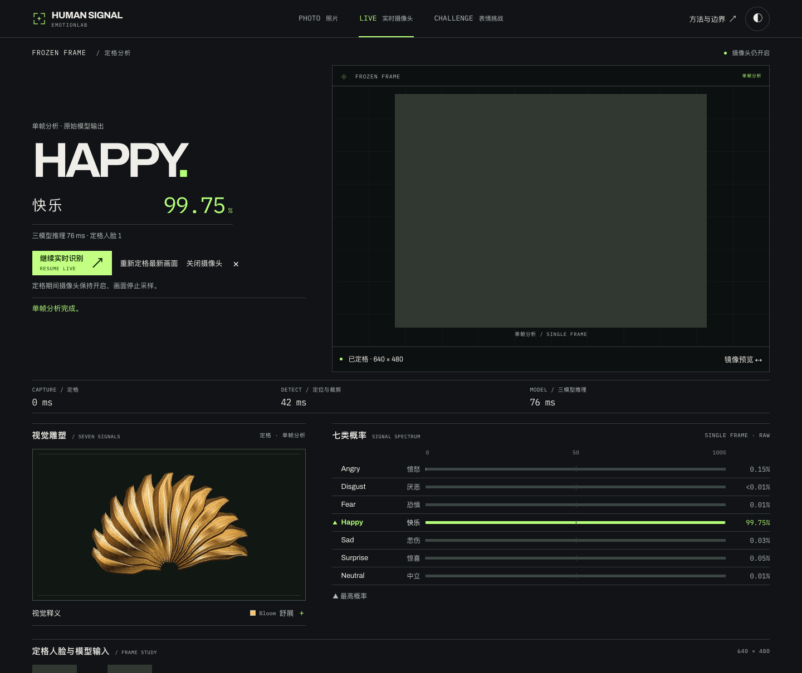
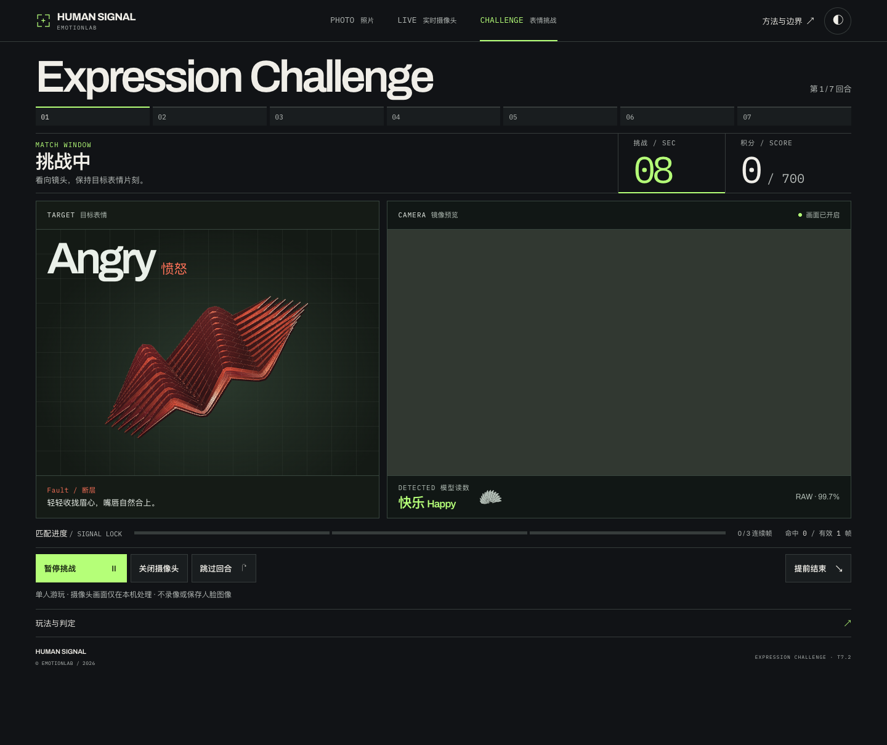
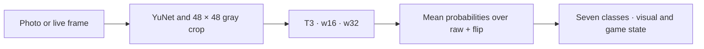

## 四人分工与代码直达

本机双击 [四人分工总览](00_四人分工总览.html)，可以在同一页查看代码和两张图。GitHub 上可直接点击下表。

| 成员 | 本版维护与讲解范围 | 直接打开源码 |
| --- | --- | --- |
| **彭云茜** | 数据处理 | [CSV 统计](data_processing/csv_statistics.py) · [读取与归一化](data_processing/dataset.py) · [训练增强](data_processing/augmentation.py) · [数据测试](tests/data/test_csv.py) |
| **雷嘉泳** | 模型与前端设计 | [基础 CNN](model_design/basic_cnn.py) · [ResNet](model_design/resnet18.py) · [前端导航](frontend/src/App.jsx) · [照片页面](frontend/src/photo/PhotoPage.jsx) · [实时观测](frontend/src/live/LiveObservation.jsx) · [表情挑战](frontend/src/challenge/ChallengePage.jsx) |
| **林鑫** | 训练与后端实现 | [训练循环与损失](training/cnn_experiment.py) · [优化器与学习率](training/resnet_experiment.py) · [超参数](configs/t37/w16_s101.json) · [后端入口](backend/server.py) · [照片推理接口](backend/routes/classification.py) · [实时帧接口](backend/routes/live.py) |
| **曹星宇** | 评估与测试 | [混淆矩阵与指标](evaluation/metrics.py) · [权重加载与推理](evaluation/inference.py) · [概率融合](evaluation/fusion.py) · [推理回归](tests/evaluation/test_inference.py) · [后端测试](tests/backend/test_routes.py) · [前端测试](tests/frontend/analysisStream.test.mjs) |

[项目总流程图](docs/项目总流程.png) · [前后端交互图](docs/前后端交互.png) · [可编辑流程图](docs/流程图.md)

这份对应表沿用四个原岗位，历史个人贡献由成员确认。


[简体中文](README.zh-CN.md) · [Install and run](docs/GETTING_STARTED.md) · [Technical documentation](docs/INDEX.zh-CN.md)

EmotionLab is a four-person course project that trains a seven-class facial expression classifier and exposes its inputs and scores through **HUMAN SIGNAL**, a local interactive exhibit. A PyTorch baseline led to small-image residual networks and a three-model probability ensemble. The React interface lets visitors trace a photo, sampled video frame or frozen frame through the same 48 × 48 grayscale classifier. Seven Signals gives each output class a distinct moving sculpture.

The classifier describes facial expression categories in an image. Its scores cannot establish a person's real emotional or psychological state.

## Explore the product

| PHOTO | LIVE |
| --- | --- |
|  |  |
| Inspect the crop and seven probabilities, then see the corresponding sculpture. | Observe raw and smoothed probability streams on sampled frames. |
| **FROZEN FRAME** | **Expression Challenge** |
|  |  |
| Re-run detection and classification on a captured frame. | Match the target with stable raw observations across timed rounds. |

[Home screen, Seven Signals and captured demonstration](docs/PRODUCT_GALLERY.md). These images show the running app. The camera-based captures use a controlled canvas stream, and photo/video pixels are masked in the exhibit. The scores shown come from local inference.

## Validation and model

| Historical PublicTest validation | Result |
| --- | ---: |
| Accuracy | **72.610755% (2,606/3,589)** |
| Macro F1 | **72.195390%** |

The BasicCNN baseline reached 54.249094%. The frozen system averages the original and horizontally flipped predictions from T3, w16 and w32, giving each of the six probability distributions equal weight. PublicTest was used repeatedly in model selection. The independent PrivateTest evaluation remains pending in the local record. [Experiment comparison and error analysis](docs/EXPERIMENTS.md)



[System and API](docs/SYSTEM_ARCHITECTURE.md) · [Residual model](docs/MODEL_ARCHITECTURE.md) · [Training](docs/TRAINING_PIPELINE.md) · [Frozen inference](docs/ENSEMBLE_INFERENCE.md)

## Try it locally

The standalone gallery runs with Node.js and needs no model or dataset.

```sh
npm ci
npm run gallery -- --port 8786
```

Open `http://127.0.0.1:8786/`. The integrated app and CLI additionally need the three separately authorized classifier checkpoints. [Install, run, test and troubleshoot](docs/GETTING_STARTED.md)

## Read the archive

- [Project history](docs/PROJECT_HISTORY.md) follows the early baseline, unsuccessful variants, accepted ensemble, product iterations and engineering checks.
- [Experiment evidence](experiments/README.md) links aggregate tables, epoch logs, accuracy/loss curves, class scores and confusion matrices.
- [Testing](docs/TESTING_AND_VALIDATION.md) records historical and archive verification conditions.
- [Team contributions](docs/TEAM_AND_CONTRIBUTIONS.md) identifies the four roles and the evidence they can discuss.
- [Credits](docs/REFERENCES.md) and [limitations](docs/LIMITATIONS.md) describe source licenses, validation constraints and intended use.
