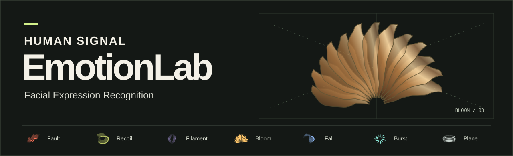
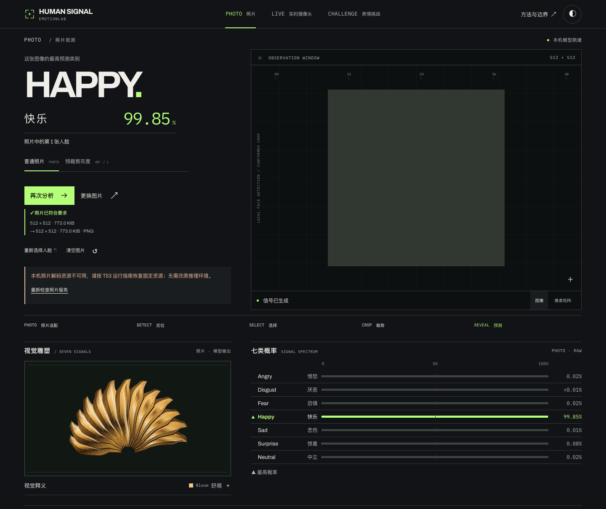
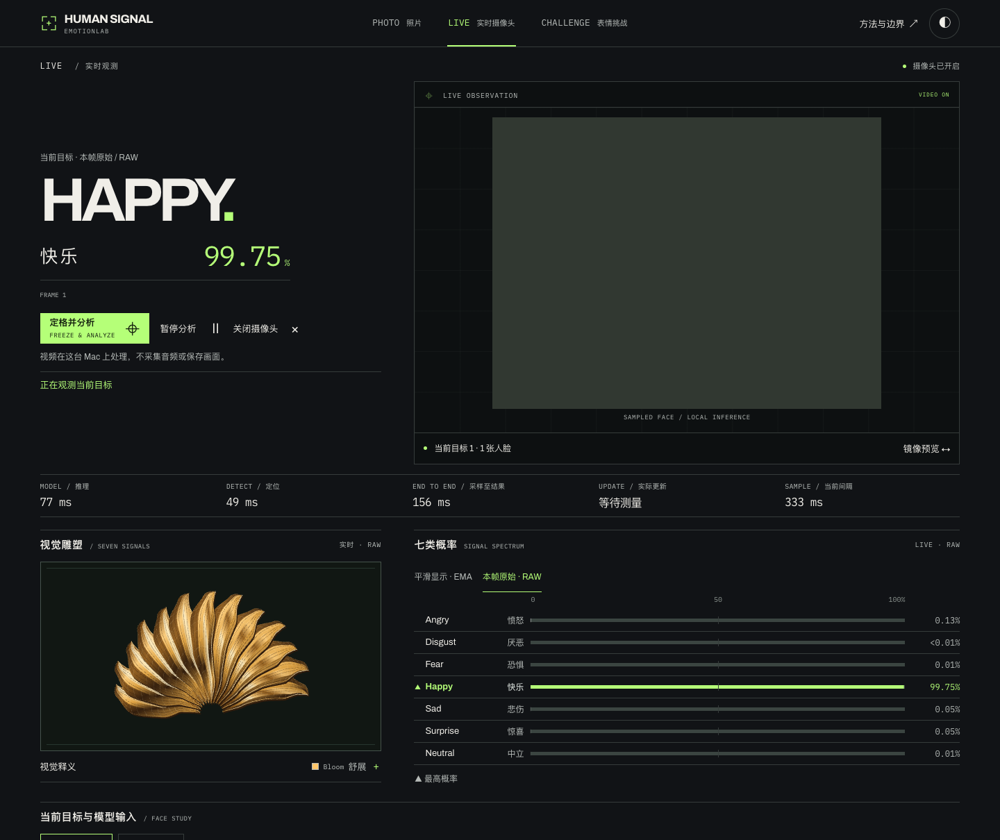
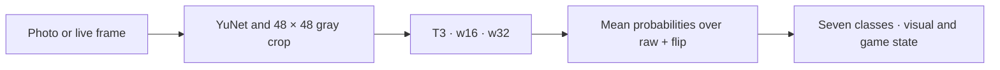

[简体中文](README.zh-CN.md) · [Install and run](docs/GETTING_STARTED.md) · [Technical documentation](docs/INDEX.zh-CN.md)

EmotionLab is a four-person course project that trains a seven-class facial expression classifier and exposes its inputs and scores through **HUMAN SIGNAL**, a local interactive exhibit. A PyTorch baseline led to small-image residual networks and a three-model probability ensemble. The React interface lets visitors trace a photo, sampled video frame or frozen frame through the same 48 × 48 grayscale classifier. Seven Signals gives each output class a distinct moving sculpture.

The classifier describes facial expression categories in an image. Its scores cannot establish a person's real emotional or psychological state.

## Explore the product

| PHOTO | LIVE |
| --- | --- |
|  |  |
| Inspect the crop and seven probabilities, then see the corresponding sculpture. | Observe raw and smoothed probability streams on sampled frames. |
| **FROZEN FRAME** | **Expression Challenge** |
|  |  |
| Re-run detection and classification on a captured frame. | Match the target with stable raw observations across timed rounds. |

[Home screen, Seven Signals and captured demonstration](docs/PRODUCT_GALLERY.md). These images show the running app. The camera-based captures use a controlled canvas stream, and photo/video pixels are masked in the exhibit. The scores shown come from local inference.

## Validation and model

| Historical PublicTest validation | Result |
| --- | ---: |
| Accuracy | **72.610755% (2,606/3,589)** |
| Macro F1 | **72.195390%** |

The BasicCNN baseline reached 54.249094%. The frozen system averages the original and horizontally flipped predictions from T3, w16 and w32, giving each of the six probability distributions equal weight. PublicTest was used repeatedly in model selection. The independent PrivateTest evaluation remains pending in the local record. [Experiment comparison and error analysis](docs/EXPERIMENTS.md)



[System and API](docs/SYSTEM_ARCHITECTURE.md) · [Residual model](docs/MODEL_ARCHITECTURE.md) · [Training](docs/TRAINING_PIPELINE.md) · [Frozen inference](docs/ENSEMBLE_INFERENCE.md)

## Try it locally

The standalone gallery runs with Node.js and needs no model or dataset.

```sh
cd web/human-signal
npm ci
npm exec -- vite build --config seven-signals/vite.config.js
npm exec -- vite preview --config seven-signals/vite.config.js
```

Open `http://127.0.0.1:8786/`. The integrated app and CLI additionally need the three separately authorized classifier checkpoints. [Install, run, test and troubleshoot](docs/GETTING_STARTED.md)

## Read the archive

- [Project history](docs/PROJECT_HISTORY.md) follows the early baseline, unsuccessful variants, accepted ensemble, product iterations and engineering checks.
- [Experiment evidence](experiments/README.md) links aggregate tables, epoch logs, accuracy/loss curves, class scores and confusion matrices.
- [Testing](docs/TESTING_AND_VALIDATION.md) records historical and archive verification conditions.
- [Team contributions](docs/TEAM_AND_CONTRIBUTIONS.md) identifies the four roles and the evidence they can discuss.
- [Credits](docs/REFERENCES.md) and [limitations](docs/LIMITATIONS.md) describe source licenses, validation constraints and intended use.
