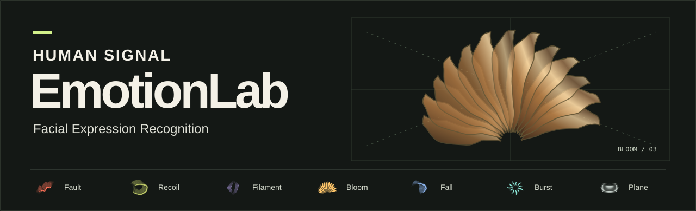
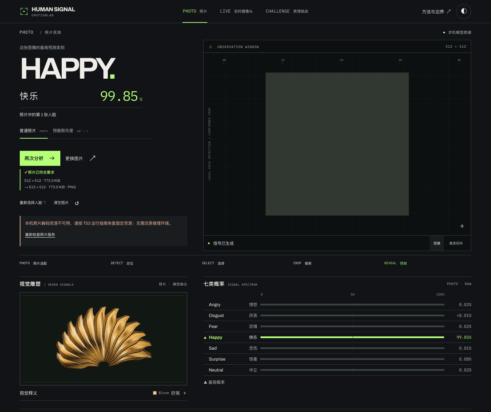
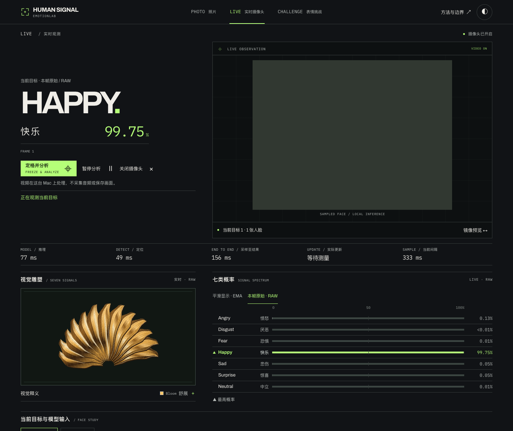
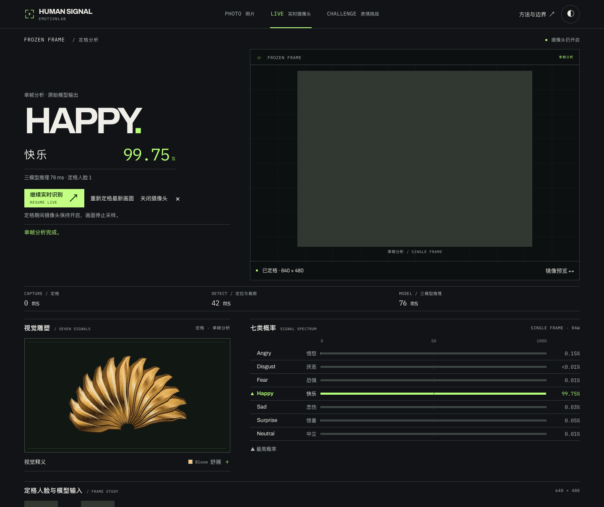
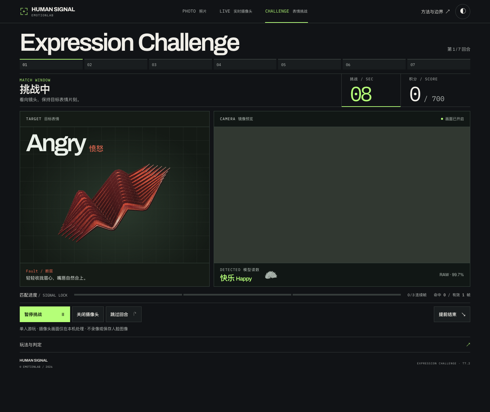

[English](README.md) · [安装与运行](docs/GETTING_STARTED.md) · [中文技术文档导航](docs/INDEX.zh-CN.md)

EmotionLab 是一个四人课程项目。我们训练七类人脸表情分类器，并把图像输入和分类结果接入本机交互展览 **HUMAN SIGNAL**。项目从 PyTorch 基础 CNN 起步，逐步采用小图残差网络与三模型概率融合。React 界面让观众观察照片、摄像头采样帧或定格画面如何进入同一个 48×48 灰度分类器，Seven Signals 为七类输出各设计了一件动态雕塑。

模型输出描述图像中的面部表情类别，无法据此确定一个人的真实情绪或心理状态。

## 产品实景

| PHOTO 照片识别 | LIVE 实时观测 |
| --- | --- |
|  |  |
| 确认裁剪，观察七类概率与对应雕塑。 | 查看同一采样路径的原始及平滑概率。 |
| **FROZEN FRAME 定格分析** | **Expression Challenge 表情挑战** |
|  |  |
| 对拍下的单帧独立定位与推理。 | 在限时回合中用连续原始帧完成稳定匹配。 |

[首页、七类雕塑与运行演示](docs/PRODUCT_GALLERY.md)。截图来自实际运行。摄像头路径使用受控画布流，展示图遮盖照片及视频像素，原样保留程序实际生成的读数。

## 验证与模型

| 历史 PublicTest 验证 | 结果 |
| --- | ---: |
| Accuracy | **72.610755%（2606/3589）** |
| Macro F1 | **72.195390%** |

基础 CNN 达到 54.249094%。冻结方案让 T3、w16 和 w32 分别处理原图与水平翻转图，六组概率各占相同权重。PublicTest 曾反复用于选模。本地记录中的独立 PrivateTest 评估仍待执行。[实验比较与误差分析](docs/EXPERIMENTS.md)


[系统和 API](docs/SYSTEM_ARCHITECTURE.md) · [残差结构](docs/MODEL_ARCHITECTURE.md) · [训练](docs/TRAINING_PIPELINE.md) · [冻结推理](docs/ENSEMBLE_INFERENCE.md)

## 本机体验

独立艺术展厅只需要 Node.js，可以直接浏览七类艺术作品。

```sh
cd web/human-signal
npm ci
npm exec -- vite build --config seven-signals/vite.config.js
npm exec -- vite preview --config seven-signals/vite.config.js
```

打开 `http://127.0.0.1:8786/`。集成应用和 CLI 还需要通过授权渠道取得三份分类器权重。[完整安装、运行、测试与排错说明](docs/GETTING_STARTED.md)

## 阅读档案

- [项目发展历程](docs/PROJECT_HISTORY.zh-CN.md) 记录基础模型、失败尝试、融合选择、交互演进与验收。
- [实验依据](experiments/README.md) 索引数表、逐轮日志、准确率和损失曲线、逐类分数及混淆矩阵。
- [测试与验证](docs/TESTING_AND_VALIDATION.md) 说明历史与当前测试的实际条件。
- [分工与贡献](docs/TEAM_AND_CONTRIBUTIONS.md) 说明四人岗位和相应证据。
- [参考及许可](docs/REFERENCES.md) 和[局限](docs/LIMITATIONS.md) 记录依赖、数据来源、验证及使用边界。
