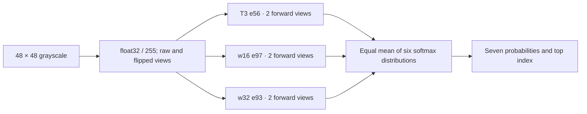

# Frozen ensemble inference

The raw and mirrored tensors each contribute ½ within a model. Each model contributes ⅓. In arithmetic terms, each of the six resulting distributions has weight ⅙. [`ensemble_math.py`](../evaluation/fusion.py) computes the equivalent probability average via double log-softmax and log-sum-exp. Averaging logits would produce different values. The combined parameter count is 4,197,845.

[`Ensemble`](../evaluation/inference.py) verifies file/image contracts, checks checkpoint hashes and state, restores each architecture, and runs CPU eval with gradients off. Historical evaluation used one thread and batch 128 including the tail batch. The [frozen manifest](../configs/inference/best_triple.json) records the weights and archived summary identifiers.

PHOTO and FROZEN FRAME use independent single-image predictions. LIVE also has an EMA display stream. The challenge consumes live raw observations. T3.5's EMA concerns train-time weight averaging. See [performance](EXPERIMENTS.md) and [commands](GETTING_STARTED.md).
