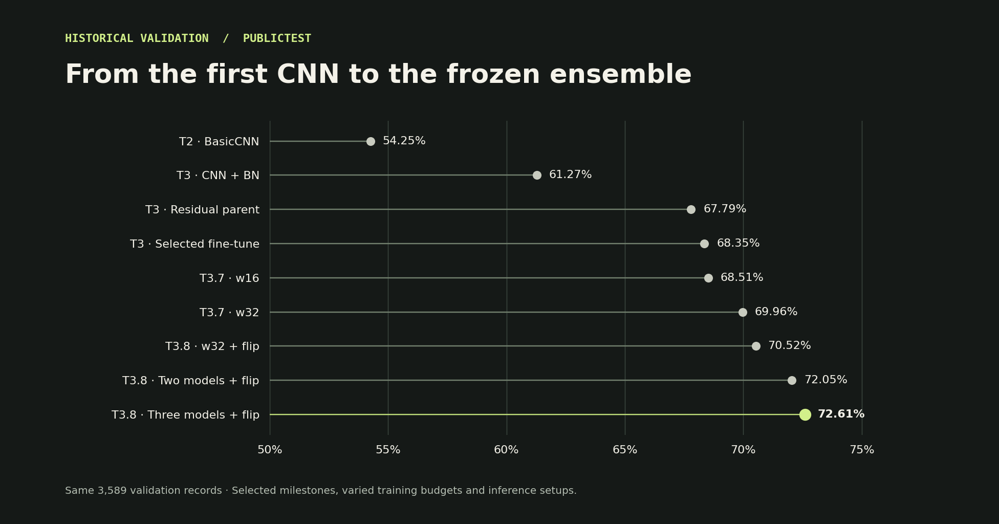
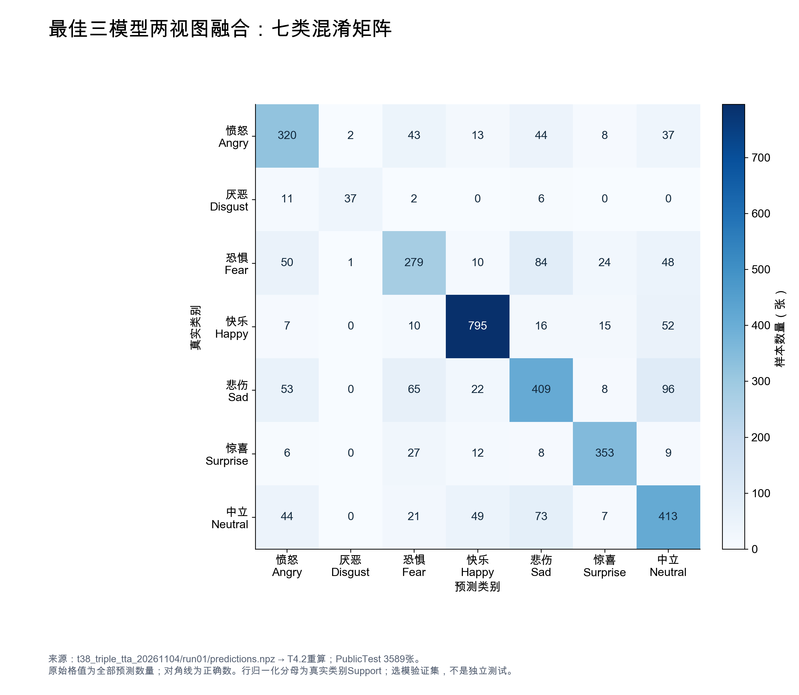

# Experiment results

The frozen three-model, two-view ensemble reached **72.610755% accuracy (2,606/3,589)**, **72.195390% Macro F1** and ordinary CE **0.8931570621** on the historical PublicTest validation split. The saved summary, aggregate tables and frozen manifest agree. Independent final holdout performance remains pending.

| Design step | Configuration | Correct | Accuracy | Macro F1 |
| --- | --- | ---: | ---: | ---: |
| T2 | BasicCNN, Adam | 1,947 | 54.249094% | 50.774396% |
| T3 | Augmented CNN with BN | 2,199 | 61.270549% | 51.683501% |
| T3 | SmallResNet parent epoch 50 | 2,433 | 67.790471% | 65.479227% |
| T3 | Unweighted fine-tune epoch 56 | 2,453 | 68.347729% | 65.979284% |
| T3.5 | C seed 42 online, strongest observed | 2,464 | 68.654221% | 65.570976% |
| T3.7 | w16 seed 101 | 2,459 | 68.514907% | 67.975057% |
| T3.7 | w32 seed 101 | 2,511 | 69.963778% | 69.262524% |
| T3.8 | w32 raw and flip | 2,531 | 70.521037% | 69.915623% |
| T3.8 | w32 + T3, two views | 2,586 | 72.053497% | 71.190234% |
| T3.8 | w32 + T3 + w16, two views | **2,606** | **72.610755%** | **72.195390%** |
| T3.8 | Three models, four-view trial | 2,597 | 72.359989% | 71.582441% |

The [full comparison](../results/t4_step2_analysis_20261104/data/model_comparison.csv) contains 32 rows, including 22 training-weight streams from 18 runs, cached metrics and inference variants. [The ledger](../experiments/README.md) links logs, accuracy, loss, learning rates and costs. [Original ensemble summary](../results/t38_triple_tta_20261104/run01/summary.json).

## Trade-offs and rejected variants

- T3's early CPU trials and continued CNN training established throughput and validation limits. Weighting changed the seed-42 fine-tune from 2,453 to 2,443 correct, and seed 43 from 2,447 to 2,449. Results vary by run.
- T3.5 tested cosine fine-tuning, label smoothing, EMA with BN refresh, and mild contrast/brightness augmentation. Its best online run had higher accuracy and lower Macro F1 than T3. The formal C EMA stream at seed 42 added five correct, with paired bootstrap bounds from −0.6687 to +0.9473 points. The project retained T3.
- T3.7's seed-101 w32 raw accuracy improved on w16, while its ordinary CE was 1.547304 versus 1.276596. The two other configured seeds have no complete comparable runs.
- w32 TTA corrected 113 and introduced 93 errors. Three-model TTA versus dual-model TTA corrected 86 and introduced 66. Four-view TTA lost nine net correct versus the two-view ensemble despite lower ordinary CE. [Paired results](../results/t4_step2_analysis_20261104/data/paired_changes.csv)

## Class behavior and errors

| Actual class | Support | Precision | Recall | F1 |
| --- | ---: | ---: | ---: | ---: |
| Angry | 467 | 65.17% | 68.52% | 66.81% |
| Disgust | 56 | 92.50% | 66.07% | 77.08% |
| Fear | 496 | 62.42% | 56.25% | 59.17% |
| Happy | 895 | 88.24% | 88.83% | 88.53% |
| Sad | 653 | 63.91% | 62.63% | 63.26% |
| Surprise | 415 | 85.06% | 85.06% | 85.06% |
| Neutral | 607 | 63.05% | 68.04% | 65.45% |

Common directed errors include Sad→Neutral (96), Fear→Sad (84), and Neutral→Sad (73). Fear had the lowest recall. Disgust had 37/56 correct, so one record changes its recall by about 1.79 percentage points. Error counts show where the classifier struggles. Causes of individual errors remain unverified. The course archive retains example-level evidence under its data policy.

[Class table](../results/t4_step2_analysis_20261104/data/best_per_class.csv) · [Normalized matrix](../results/t4_step2_analysis_20261104/data/confusion_normalized.csv) · [Ranked errors](../results/t4_step2_analysis_20261104/data/error_confusions.csv) · [Selection bias and other limits](LIMITATIONS.md)
