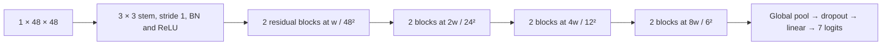

# Model architecture

| Model | Main path | Parameters | Selected epoch |
| --- | --- | ---: | --- |
| T2 BasicCNN | 3 × 3 Conv 1→16→32→64, ReLU and max-pool per stage, FC 2304→128→7, dropout 0.3 | 319,239 | 15 |
| T3 SmallResNet | Stride-1 grayscale stem, four residual stages [2,2,2,2] at 16/32/64/128, global average pool, dropout 0.3, FC 7 | 700,791 | 56 |
| T3.7 w16 | Same stage widths and depth; explicit Kaiming initialization | 700,791 | 97, seed 101 |
| T3.7 w32 | 32/64/128/256, same depth and head | 2,796,263 | 93, seed 101 |

Each block has two 3 × 3 convolutions with BN and an intermediate ReLU. A shape-preserving path uses identity, while shape changes use a 1 × 1 projection and BN. ReLU follows the sum. The stride-1 stem keeps all spatial positions at entry. Stage transitions downsample.

[Baseline code](../src/model.py) · [T3 blocks](../src/t3_models.py) · [T3.7 models](../src/t37_models.py) · [Frozen manifest](../configs/inference/best_triple.json)
