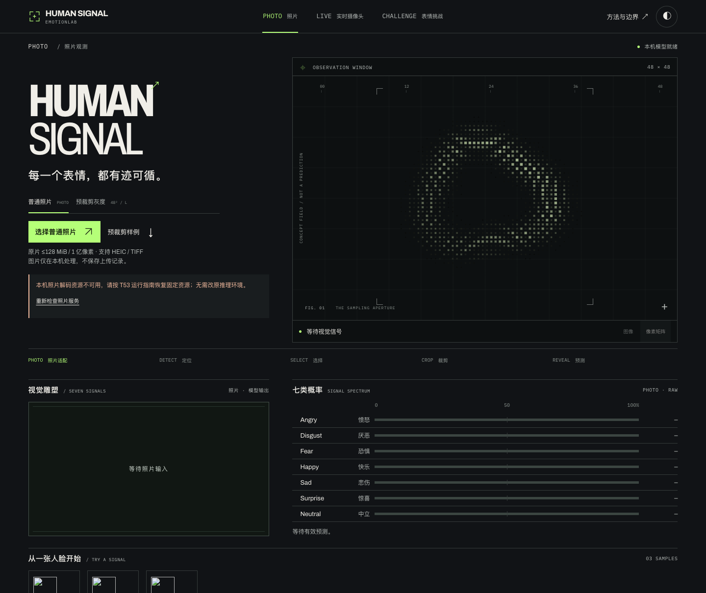
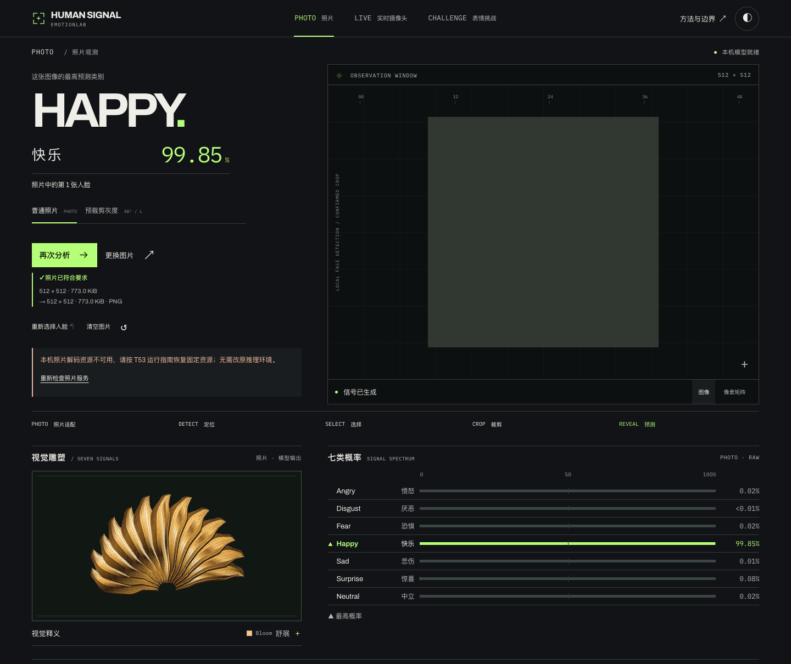
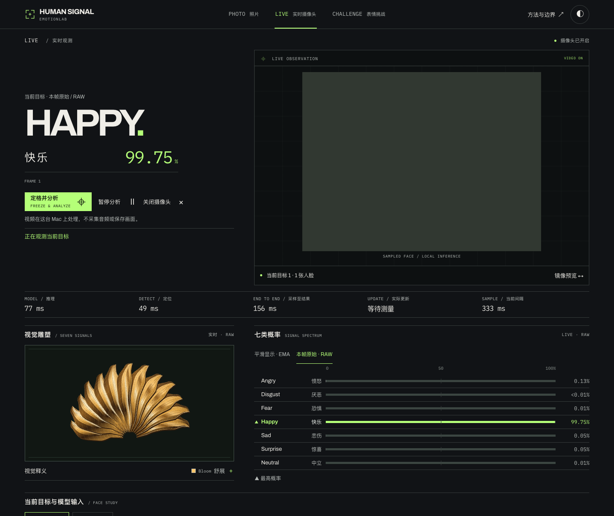
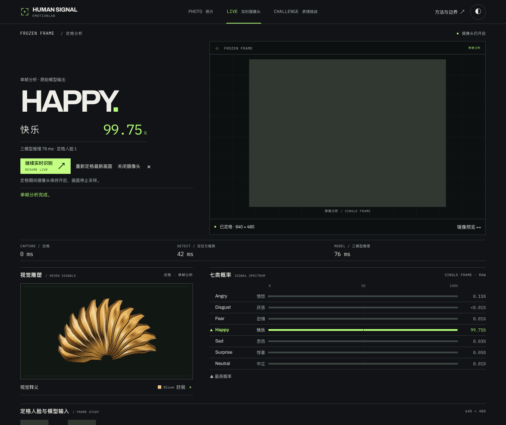
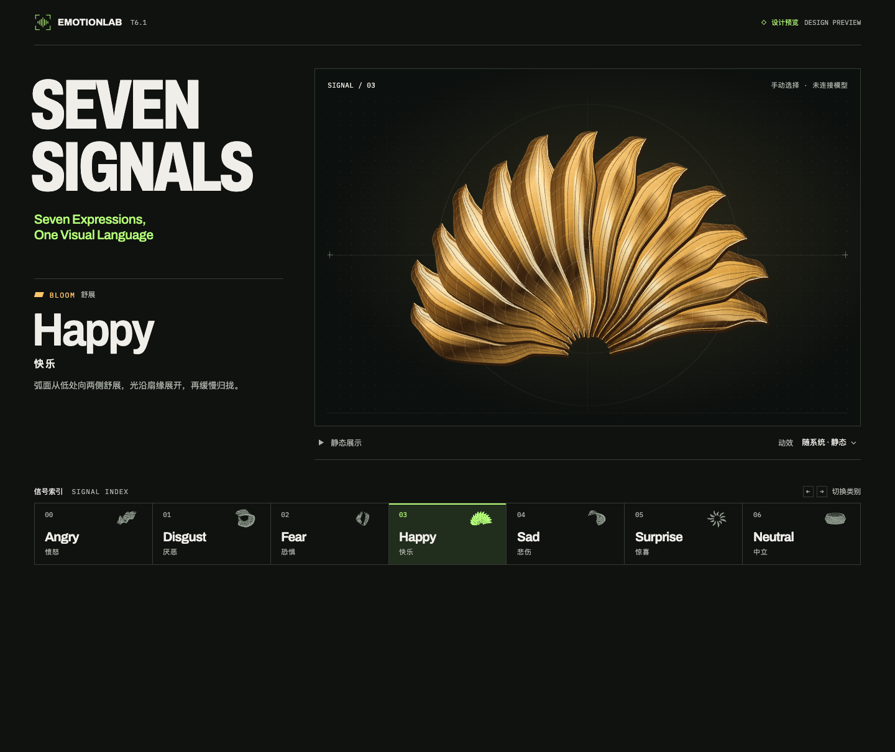
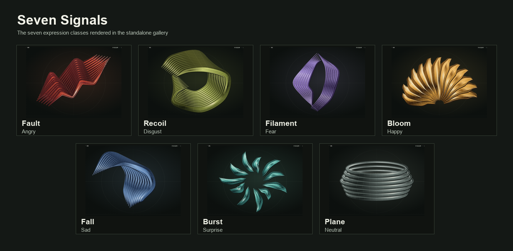
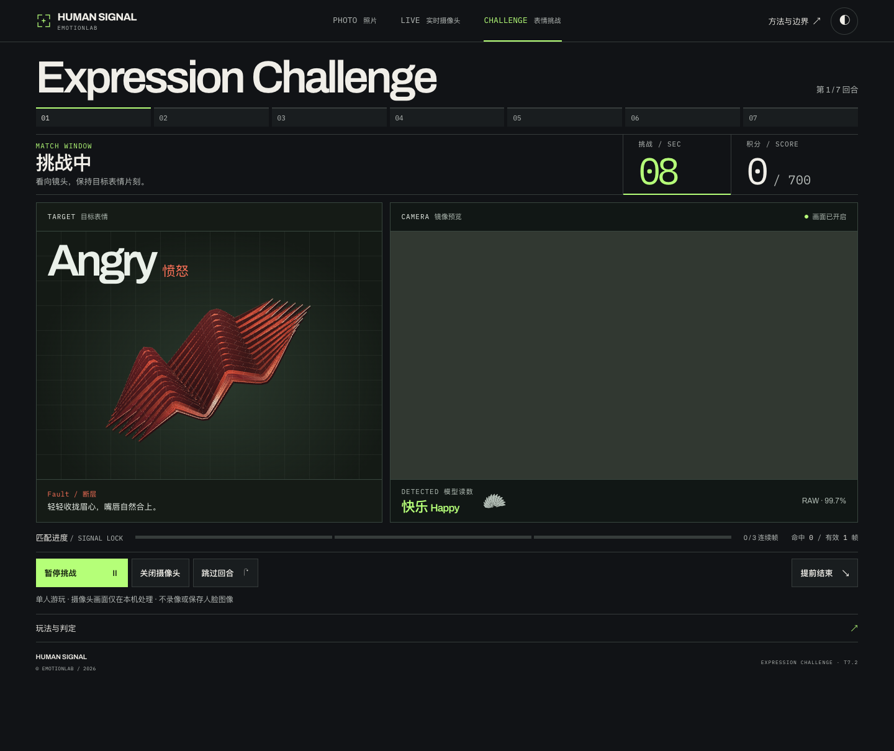

# Product gallery

These are captures of the actual T7.2 build running on a loopback service. A local public-domain NASA photograph was used as a PHOTO fixture and as a controlled canvas source for camera paths. The published captures mask image, crop and video pixels. Displayed probabilities and UI states come from the running software. The demo does not record a physical camera or serve as an accuracy measurement. [Fixture provenance at scikit-image](https://scikit-image.org/docs/stable/api/skimage.data.html#skimage.data.astronaut)

## App entry

## PHOTO and LIVE

The PHOTO capture follows face selection, the 48 × 48 confirmation and a fresh prediction. The LIVE capture is a real sampled request from the controlled video source. The raw output contains seven values.

## FROZEN FRAME

An independent call analyzes the captured frame. The camera stream can then be resumed or closed.

## Seven Signals

The standalone preview uses manual selection. The seven sculpture surfaces shown below were rendered by the project code.

[Animated rendering of Bloom](../assets/seven-signals-motion.gif) · [Visual and motion design](SEVEN_SIGNALS.md)

## Expression Challenge

The screenshot shows an active round with the target and detected signal separated. This isolated run finished early after the observed round. Full controlled-game results are recorded in [testing and validation](TESTING_AND_VALIDATION.md).

