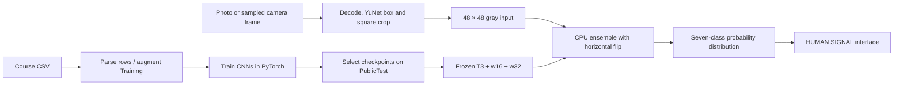
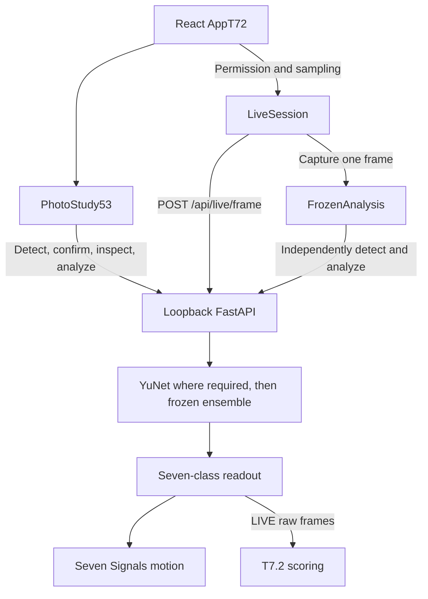

# System architecture

Coursework begins with cropped grayscale faces. Product input adapters also handle ordinary photos and sampled camera frames. These paths converge at the same tensor normalization and classifier.

[`src/t62_web.py`](../src/t62_web.py) serves the T7.2 build via [`src/t54_web.py`](../src/t54_web.py), which layers LIVE over T5.3 compatibility, T5.2 detection and T5.1 inference. [`AppT72.jsx`](../web/human-signal/src/AppT72.jsx) owns layout and mode orchestration. Uvicorn listens on loopback. One ensemble is loaded per server process.

| Route | Implementation | Output or role |
| --- | --- | --- |
| `GET /api/health` | T5.1 | Readiness, labels and stored validation summary |
| `POST /api/inspect`, `/api/analyze` | T5.1 | Gray input validation and streamed inference events |
| `GET /api/photo-info`, `POST /api/detect` | T5.2 | Bounded decoding and face/crop candidates |
| `GET /api/photo-compat`, `POST /api/prepare-photo` | T5.3 | Optional macOS ImageIO subprocess |
| `GET /api/live/info`, `POST /api/live/frame` | T5.4 | Frame observations, tracking and explicit status |
| `GET /experiments/` | T8.3 | Four allowlisted aggregate charts |

[Model structure](MODEL_ARCHITECTURE.md) · [Training](TRAINING_PIPELINE.md) · [Inference](ENSEMBLE_INFERENCE.md) · [Directory tree](REPOSITORY_TREE.md)
