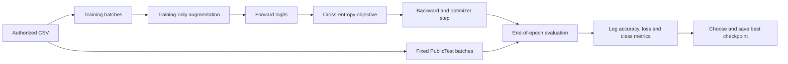

# Training pipeline

| Phase | Recipe | Checkpoint and evidence |
| --- | --- | --- |
| T2 | Adam, batch 128, 15 epochs, CPU, LR 0.001 | Epoch 15 |
| T3 | Nine saved recipes. Selected path uses Adam, batch 256, flip and translation, then an 8-epoch fine-tune initialized from epoch 50 with initial LR 0.0002 | Unweighted seed 42, epoch 56 |
| T3.5 | Six 18-epoch fine-tunes from the same parent, reset Adam, cosine 0.00015→0.000005, variations in smoothing, EMA and light/color augmentation | Track online and EMA separately. Log ordinary CE alongside the training objective |
| T3.7 | SGD momentum 0.9, Nesterov, decay 0.0005, batch 128. Five warmup epochs from 0.005 to 0.05 then cosine to 0.00001. Flip and ±4 px reflected translation | 100 epochs each at seed 101. Prefer accuracy, lower CE, then earlier epoch |

Eval mode fixes BN state and disables dropout. Online training metrics integrate changing weights and configured augmentation. PublicTest metrics measure the end-of-epoch state. The historical fixed Training-versus-PublicTest check evaluated the same weights on both splits.

[Baseline trainer](../src/train.py) · [T3](../src/t3_train.py) · [T3.5](../src/t35_train.py) · [T3.7](../src/t37_train.py) · [Configs](../configs/) · [Run ledger](../experiments/README.md)
