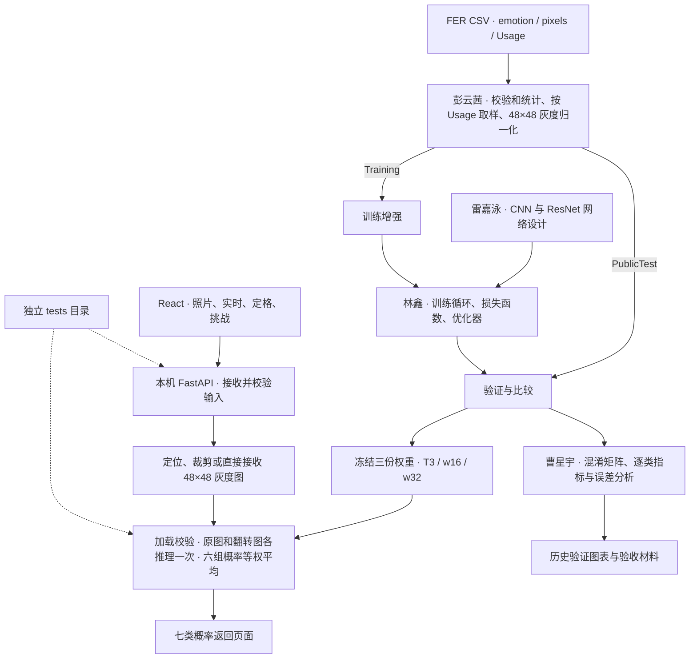
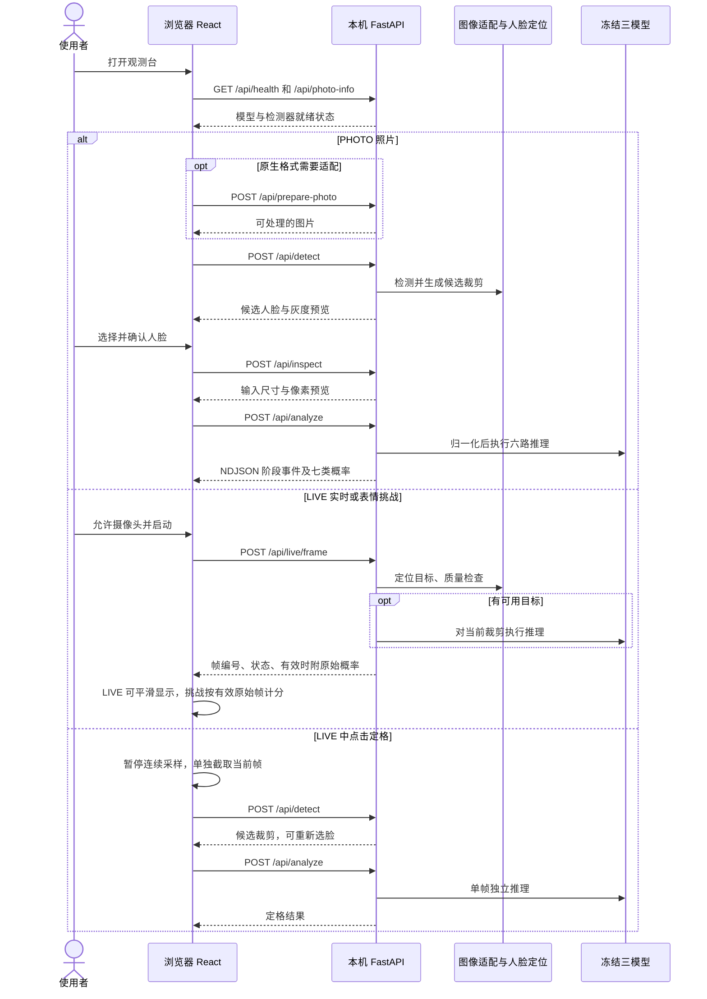

# EmotionLab 项目与前后端交互

[直接打开项目总流程图](项目总流程.png) · [直接打开前后端交互图](前后端交互.png)

## 项目总流程

Training 用于更新权重，PublicTest 曾用于验证和选模。图中的模型评估指标来自历史验证。PrivateTest 未运行。

## 前后端交互

预裁剪的 48×48 灰度图片直接进入 inspect 和 analyze。服务在启动时加载模型，忙碌或无可用人脸时返回对应状态。实际路由见 [backend/routes](../backend/routes/)，模式切换见 [App.jsx](../frontend/src/App.jsx)。
